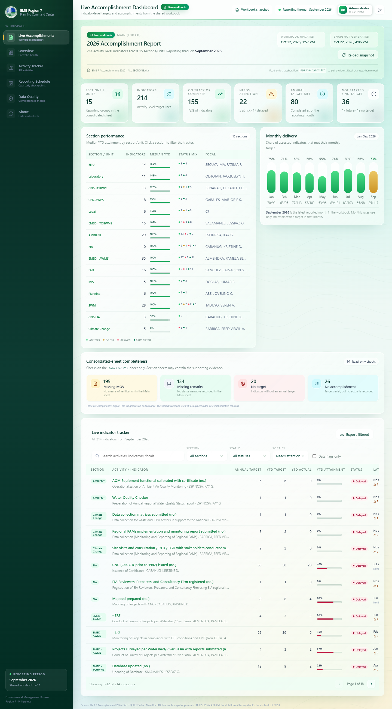

# EMB Region 7 — 2026 Planning Dashboard

<p align="center">
  
</p>

<p align="center">
  <a href="#quick-start">
    
  </a>
  <a href="#sign-in-gate">
    
  </a>
  <a href="#keeping-it-live">
    
  </a>
  <a href="LICENSE">
    
  </a>
</p>

<p align="center">
  <strong>Read-only planning intelligence for the EMB Region 7 2026 accomplishment workbook.</strong><br />
  Every page reads the same snapshot of the shared workbook — 214 indicator lines,
  129 activity groups, 15 units, 645 quarterly checkpoints, through September 2026.
  No sample data anywhere.
</p>

<p align="center">
  <a href="docs/screenshots/sign-in.png">Sign-in</a> ·
  <a href="docs/screenshots/overview.png">Executive Overview</a> ·
  <a href="docs/screenshots/tracker.png">Activity Tracker</a> ·
  <a href="docs/screenshots/timeline.png">Reporting Schedule</a> ·
  <a href="docs/screenshots/data-quality.png">Data Quality</a> ·
  <a href="docs/screenshots/project-detail.png">Activity detail</a> ·
  <a href="docs/screenshots/about.png">About</a> ·
  <a href="docs/screenshots/live-mobile.png">Live mobile</a> ·
  <a href="docs/screenshots/mobile-overview.png">Mobile</a>
</p>

---

## Why this dashboard

EMB Region 7 reports its 2026 accomplishments in one Excel workbook — a monthly
matrix with targets, actuals, remarks, and means of verification for every unit.
That file is the source of truth, but it is hard to read, hard to search, and
impossible to scan for risk.

This dashboard turns that file into a single, read-only view that any authorized
staff member can open in a browser:

- **Live Accomplishments** — indicator-level targets and actuals, section medians,
  monthly delivery, completeness checks, searchable tracker, record drawer, CSV export.
- **Executive Overview** — portfolio KPIs, status mix, unit performance, median
  attainment, and a delivery-against-plan S-curve.
- **Activity Tracker** — every activity group with its targets, actuals, focal staff,
  and completeness flags.
- **Reporting Schedule** — the 2026 year with quarterly target checkpoints, auto-centered
  on the reporting month.
- **Data Quality** — missing remarks, missing MOV, uncovered targets, overdue
  checkpoints, and a composite health score.
- **About** — what the dashboard reads and how to keep it live.

Every figure comes from the workbook. Nothing is invented to fill gaps that the
workbook does not cover.

---

## Quick start

Requirements: Node.js 18 or newer and npm.

```powershell
cd "F:\EMED PROJECT\Planning Dashboards"
npm install
npm run dev
```

Open <http://localhost:5173/>. If `registry.npmjs.org` is blocked on the office
network, install through an approved mirror instead:

```powershell
npm install --registry=https://registry.npmmirror.com --no-audit --no-fund
```

Production build:

```powershell
npm run build
npm run preview
```

The build output is written to `dist/`. The app uses hash routing, so the built
files work on any static host without server-side rewrite rules.

> The development server is currently running at
> <http://127.0.0.1:5173/> if it is still active in the terminal session.

---

## Data: everything comes from the shared workbook

There is **no sample data anywhere**. Every page reads the same snapshot of the
2026 accomplishment workbook (`Main (for CO)` sheet).

| Layer | What it is |
|-------|------------|
| 214 indicator lines | Each performance-indicator row with its 12 monthly targets, 12 monthly actuals, remarks, MOV, and status |
| 129 activities | The workbook's own `PROGRAM / PROJECTS / ACTIVITIES` headings, each grouping its indicator lines |
| 15 units | The workbook's `SECTION / UNIT` headings |
| 645 quarterly checkpoints | Q1–Q4 plus full-year, target summed from the monthly target columns |
| Monthly progress series | Cumulative attainment per month, from the monthly actual columns |

Status and risk are read off the workbook's own numbers:

- **Completed** — annual actual ≥ annual target
- **On Track** — YTD attainment ≥ 90%
- **At Risk** — YTD attainment 70–90%
- **Delayed** — YTD attainment < 70%
- **Not Started** — target exists but no YTD target yet
- **No Target / Unplanned** — no annual target recorded
- **Risk** — Low ≥ 90%, Medium 70–90%, High < 70%

> Budgets, phases, funding sources, and update logs are **not present in the
> workbook**, so they are not shown anywhere. Nothing is invented to fill those
> gaps — the views were rebuilt around the fields that actually exist.

---

## Keeping it live

The browser always fetches `public/live-data.json` with a cache-busting query
string, so a refresh picks up the newest snapshot. Three ways to keep it current:

### 1. One-shot sync from the local OneDrive copy

```powershell
npm run sync:live
```

### 2. Auto-sync (recommended for the office)

```powershell
npm run watch:live
```

Watches the workbook's timestamp and rebuilds the snapshot the moment a unit
saves it. Leave this running on the machine that has OneDrive synced; the
dashboard then updates itself.

### 3. Pull straight from the shared SharePoint file

```powershell
npm run sync:graph
```

Uses the Microsoft Graph API so a deployed dashboard reads the shared workbook
rather than a local copy. Requires a one-time app registration — see the setup
notes at the top of `scripts/graph_live_data.py`:

```powershell
EMB_TENANT_ID     = <tenant id>
EMB_CLIENT_ID     = <app client id>
EMB_CLIENT_SECRET = <app secret>
EMB_SITE          = r7planning_emb_gov_ph
EMB_DRIVE         = personal
EMB_FILE_ID       = <item id from the share link>
```

Add `Files.Read.All` (or `Sites.Read.All`) as an application permission and
grant admin consent.

---

## Sign-in gate

The dashboard opens on a login screen. Five accounts are issued for this
rollout, one per role:

| Role | Unit |
|------|------|
| Administrator / IT Support | EMB Region 7 Planning Unit |
| Planning Focal | ORD-PLANNING |
| ORD Focal | ORD |
| CPD Focal | CPD |
| Ambient Focal | Ambient Air Quality Monitoring |

Account usernames and passwords are issued by IT Support and are **not** committed
to this repository. Passwords are stored as PBKDF2-SHA256 hashes (120,000
iterations) in `src/lib/auth.ts` — never as plaintext. The session lives in
`sessionStorage`, so closing the tab signs the user out. The topbar shows the
signed-in name and role with a sign-out button.

To rotate a password, generate a new hash pair and replace the matching
`account` entry:

```powershell
npm run hash-password -- "NewPassword@2026!"
```

> **Important:** this is a browser-level gate on a static build. It prevents
> casual access and gives each account a named role, but it is **not** real
> access control. If the dashboard is published outside the office, put it
> behind Microsoft Entra ID, SharePoint authentication, or an Azure Static
> Web Apps function, and rotate the seeded passwords first.

---

## Interactive charts

Every chart supports hover inspection, keyboard access, and click-to-filter.
Tooltips use a shared glass panel defined in
`src/components/charts/ChartTooltip.tsx`.

| Chart | Page | Interaction |
|-------|------|-------------|
| Portfolio status donut | Overview | Hover highlights the segment, dims the others, and rewrites the centre readout. Click filters the tracker by status. |
| Performance by unit bars | Overview | Hover shows the unit, status, count, and share. Click filters the tracker by unit **and** status. |
| Delivery against plan | Overview | Hover anywhere draws a crosshair and reports achieved, plan, and variance. |
| Monthly delivery | Live | Hover shows the met rate, met count, assessed count, and median rate. Click filters the tracker to indicators active in that month. |
| Portfolio schedule (Gantt) | Reporting Schedule | Hovering a row reports status, attainment, phase, dates, duration, checkpoints, and elapsed window. Click opens the activity drawer. |

Filtering from a chart navigates to the Activity Tracker with the matching unit
and status already applied. The live monthly chart adds a removable `month`
chip in the tracker toolbar.

---

## DENR logo

`assets/DENR LOGO.png` is the source seal. It was resized into
`assets/denr-logo-{16,32,64,192,256,512}.png` for the UI and the browser tab.
`src/components/DenrLogo.tsx` renders it with a slow float, a pulsing halo, a
light sweep, and — on the sign-in screen — a gentle rotation. All motion is
disabled under `prefers-reduced-motion`.

---

## Repository map

```text
Planning Dashboards/
├─ src/
│  ├─ App.tsx                  routing, auth gate, project drawer
│  ├─ components/              layout, filters, drawer, charts, shared UI
│  ├─ live/                    live workbook types and API
│  ├─ state/                   WorkbookContext, FiltersContext
│  ├─ pages/                   Live, Overview, Tracker, Timeline, DataQuality, About
│  ├─ lib/                     metrics, csv, format, auth, status
│  ├─ index.css                design tokens and glass primitives
│  ├─ legal-theme.css          component styling
│  ├─ login-theme.css          sign-in screen and DENR logo
│  └─ workbook-theme.css       real-workbook page additions
├─ scripts/
│  ├─ sync_live_data.py        workbook -> public/live-data.json
│  ├─ live_projects.py         activity groups, checkpoints, progress series
│  ├─ watch_live_data.py       auto-rebuild on workbook change
│  ├─ graph_live_data.py       pull the workbook from SharePoint via Graph
│  └─ hash_password.py          generate PBKDF2 salt/hash pairs
├─ docs/                       production blueprint
├─ public/                     live-data.json, favicon, DENR logo
├─ assets/                     source seal and resized variants
├─ index.html
├─ package.json
└─ vite.config.ts
```

---

## Production documentation

| Document | Contents |
| --- | --- |
| [`docs/DATA_DICTIONARY.md`](docs/DATA_DICTIONARY.md) | Field-by-field schema for the SharePoint lists, validation rules, views, permissions, and workbook migration mapping. |
| [`docs/POWER_QUERY_M.md`](docs/POWER_QUERY_M.md) | Power Query M queries for SharePoint, lookup expansion, typing, and the date table. |
| [`docs/DAX_MEASURES.md`](docs/DAX_MEASURES.md) | Measure library for portfolio KPIs, schedule performance, milestones, data quality, RAG status, and RLS. |
| [`docs/POWER_BI_BUILD_GUIDE.md`](docs/POWER_BI_BUILD_GUIDE.md) | Data model, relationships, theme, page-by-page visual specifications, publish, embed, and QA. |
| [`docs/POWER_AUTOMATE_FLOWS.md`](docs/POWER_AUTOMATE_FLOWS.md) | Update logging, stale reminders, escalation, milestone reminders, and weekly digest flows. |
| [`docs/DEPLOYMENT.md`](docs/DEPLOYMENT.md) | Static hosting options, Entra ID protection, GitHub/Azure deployment, security checklist, and rollback. |
| [`powerbi/EMB-R7-Theme.json`](powerbi/EMB-R7-Theme.json) | Importable Power BI theme matching the prototype's palette and typography. |

---

## Deployment

For a quick internal review, run `npm run build` and serve `dist/` from any static
web server. Because the app uses hash routing, no rewrite rules are required.

For anything containing real project data, **do not deploy to a public host**.
Use one of these instead:

1. **Azure Static Web Apps** with Microsoft Entra ID sign-in restricted to the EMB
   tenant. Recommended if the prototype will be shared with staff.
2. **Internal IIS** with Windows Authentication, on a server reachable only from
   the EMB network.
3. **Power BI embedded in SharePoint** once the production report exists. This is
   the recommended long-term path for the live dashboard.

See [`docs/DEPLOYMENT.md`](docs/DEPLOYMENT.md) for the configuration details.

---

## What is needed to move to production

The dashboard is intentionally decoupled from tenant access. The following inputs
unlock the SharePoint and Power BI build:

1. **Workbook access** — the shared workbook URL requires tenant sign-in. The
   current live snapshot was generated from the local OneDrive copy; production
   should read from SharePoint or Power BI, not a static JSON file.
2. **Power BI licensing** — confirm whether the office has Power BI Pro, Premium
   Per User, Fabric capacity, or Microsoft 365 E5. This determines the sharing and
   embedding path.
3. **SharePoint site ownership** — owner access to the `r7planning` site (or a new
   team site) to create the three lists, set permissions, and add the report page.
4. **Data ownership** — a named owner and update cadence for each program, plus a
   decision on who can edit versus view.

Until those are available, the dashboard is the design contract: it shows exactly
what the report should do, what each field means, and how the production pieces fit
together.

---

## Add Me — K3nt-Bytes

<p align="center">
  <a href="https://github.com/K3nt-Bytes">
    
  </a>
  <a href="mailto:geocheckcentralvisayas@gmail.com">
    
  </a>
</p>

I'm **K3nt Agbayani** (`K3nt-Bytes`) — developer of the EMB Region 7
planning and legal dashboards, building internal decision-support tools on the
Microsoft 365 stack (React, TypeScript, Vite, SharePoint, Power BI, Python).

### GitHub repositories

| Repository | Description |
|------------|-------------|
| [EMB-7-LEGAL-DOCKET](https://github.com/K3nt-Bytes/EMB-7-LEGAL-DOCKET) | Read-only monitoring dashboard for the EMB Region 7 2026 legal docket — cases, enforcement, payments, complaints, LBC tracking, and DPWH compliance. Self-contained single-file HTML build. |
| [EMB-7-PLANNING-DASHBOARD](https://github.com/K3nt-Bytes/EMB-7-PLANNING-DASHBOARD) | This repository — interactive planning dashboard built on the 2026 accomplishment workbook. Live refresh, interactive charts, sign-in gate, DENR branding. |
| [DENR-EMB-7-Central-Visayas-AQMS-Live-Tracker](https://github.com/K3nt-Bytes/DENR-EMB-7-Central-Visayas-AQMS-Live-Tracker) | Live air-quality monitoring tracker for Central Visayas. |
| [ENVIS Dashboards](https://github.com/K3nt-Bytes/ENVIS-Dashboards) | ENVIS dashboard suite — official release 1.0.9. |

### Connect

- **GitHub** — <https://github.com/K3nt-Bytes>
- **Email** — <geocheckcentralvisayas@gmail.com>
- **Open an issue** — questions and feature requests are welcome on any of the
  repositories above.

> If you use any of these dashboards internally, please credit the work and
> keep the internal-data handling rules in mind — the snapshots contain real
> EMB Region 7 records.

---

## Notes for developers

- Stack: React 18, TypeScript, Vite, hand-built SVG charts, Lucide icons. No chart
  library and no backend.
- The data layer is the workbook snapshot. `FiltersContext` reads the real
  activity groups from `WorkbookContext`; the live view is the same snapshot
  with indicator-level detail. Replacing the snapshot with a live API means
  adding a data provider; production should use SharePoint/Power BI rather than
  this static file.
- The build was installed from an npm mirror in this environment because the
  public registry was unreachable. `package-lock.json` has been normalized to
  the standard `registry.npmjs.org` URLs; if your network requires a mirror, run
  `npm install --registry=<your-mirror>`.
- `npm run build` runs TypeScript type-checking before bundling. Keep it clean.
- The app has no analytics, cookies, or third-party network calls. The live view
  makes a same-origin request for `live-data.json`.

---

## License

This project is licensed under the **EMB-7-MIS Internal Software License** — see
[`LICENSE`](LICENSE) for the full text.

Copyright © 2026 **EMB DENR 7** · Created by **K3nt-Bytes**.

The software, its embedded snapshot, and any exported or displayed data may
contain personal and confidential information. Treat the dashboard and its
outputs as internal-use documents. No part of this software may be
redistributed, published, sold, or made publicly available without prior written
authorization from EMB DENR 7.